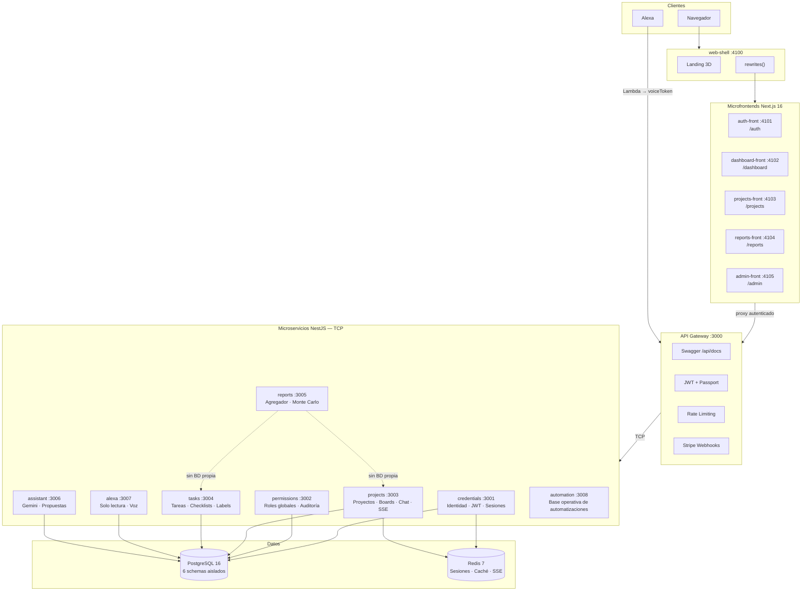
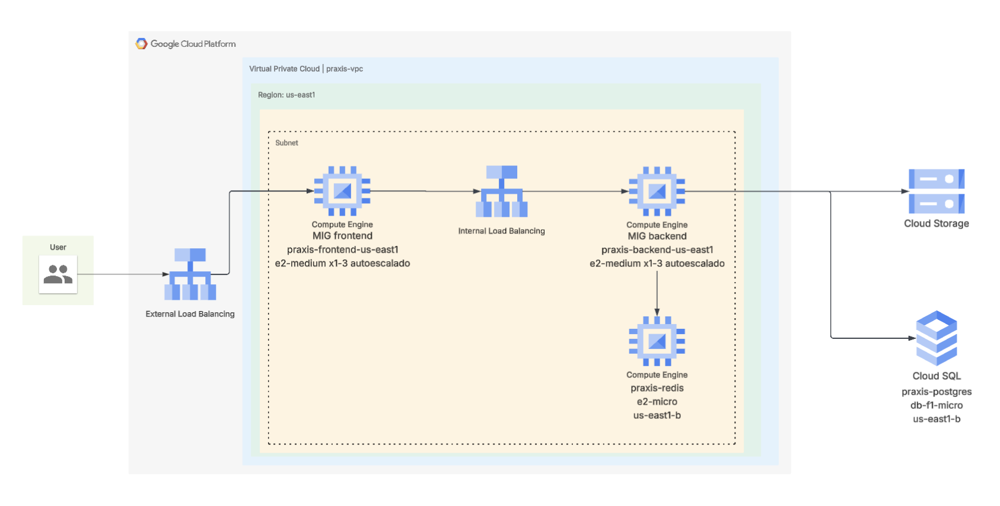
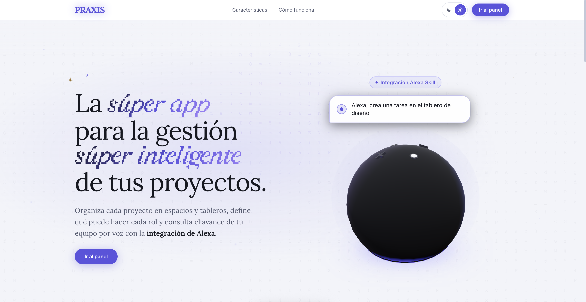
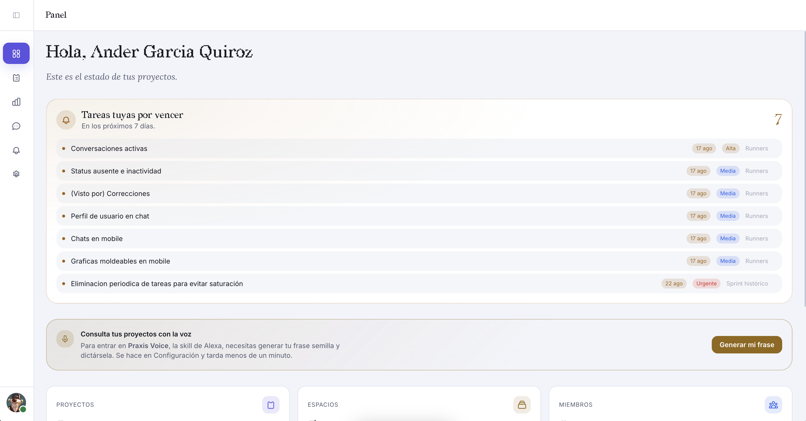
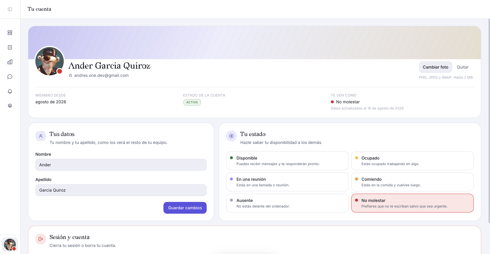
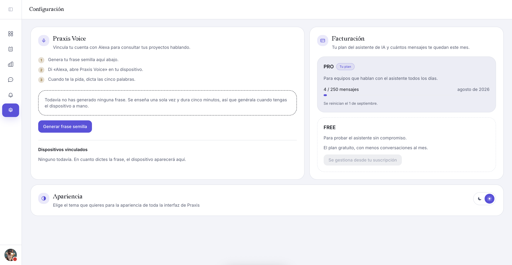
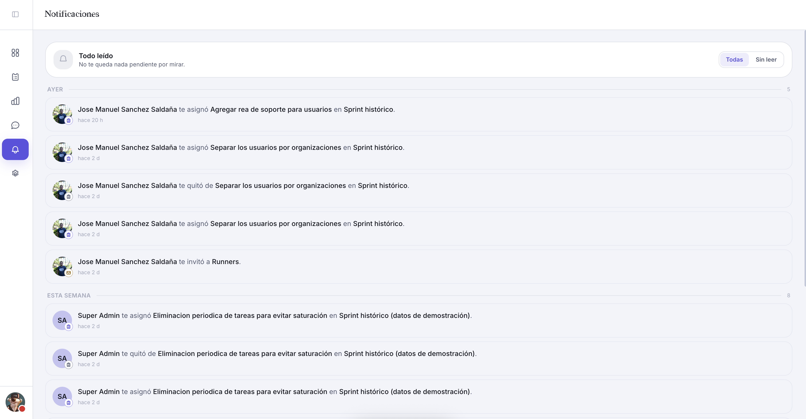
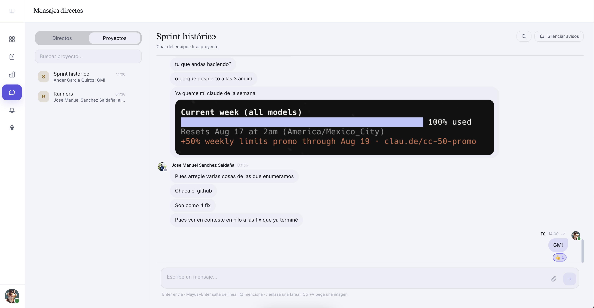
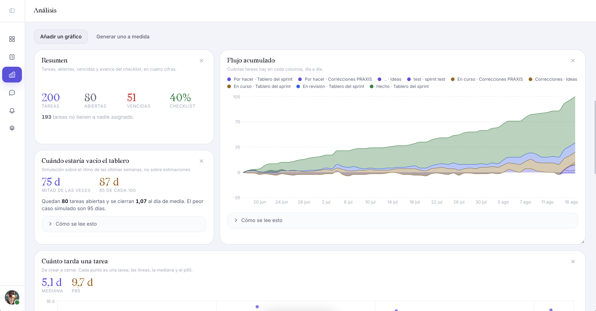
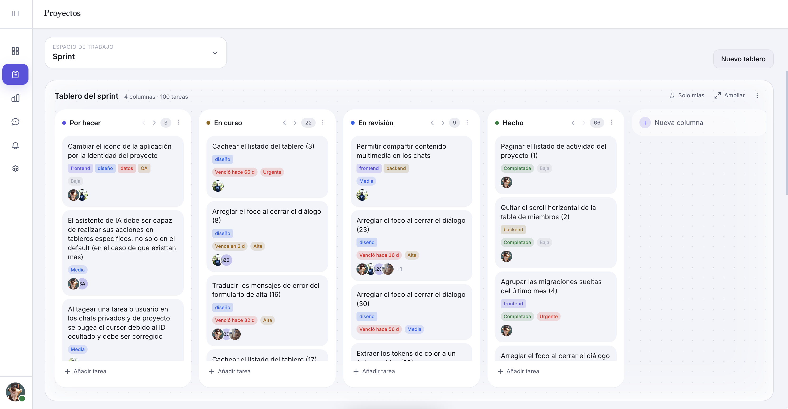

<div align="center">


<!-- docs/assets/praxis-banner.png | Logo de PRAXIS centrado sobre fondo oscuro limpio, tipografía sans-serif moderna | 1280×640, horizontal | Imagen estática PNG -->

# PRAXIS

**Gestión de proyectos ágil con tableros Kanban, reportes predictivos y asistente de voz.**

[](#-stack-tecnológico)
[](#-stack-tecnológico)
[](#-stack-tecnológico)
[](#-stack-tecnológico)
[](#-stack-tecnológico)
[](#-licencia)

</div>

---

#  Tabla de contenido

- [Sobre el proyecto](#-sobre-el-proyecto)
- [Arquitectura](#-arquitectura)
- [Stack tecnológico](#-stack-tecnológico)
- [Estructura del proyecto](#-estructura-del-proyecto)
- [Requisitos previos](#-requisitos-previos)
- [Instalación y configuración](#-instalación-y-configuración)
- [Uso y comandos](#-uso-y-comandos)
- [Variables de entorno](#-variables-de-entorno)
- [Pruebas](#-pruebas)
- [Despliegue](#-despliegue)
- [Capturas de pantalla](#-capturas-de-pantalla)
- [Roadmap](#-roadmap)
- [Contribuciones](#-contribuciones)
- [Licencia](#-licencia)

---

#  Sobre el proyecto

PRAXIS es una plataforma de gestión de proyectos construida sobre una arquitectura SOFEA (Service-Oriented Front-End Architecture). Combina tableros Kanban interactivos, un sistema de permisos granular de tres capas, reportes con pronósticos Monte Carlo, chat en tiempo real con SSE, facturación con Stripe y un asistente conversacional impulsado por Gemini — accesible también por voz a través de una skill de Alexa.

El frontend se organiza como **microfrontends Multi-Zone** de Next.js: cada zona es una aplicación independiente con su propio `basePath`, servida a través del `web-shell` central mediante `rewrites()`. El backend es un conjunto de **microservicios NestJS** que se comunican por TCP nativo detrás de un API Gateway único.


<!-- docs/assets/product-demo.gif | Recorrido corto: login → dashboard con métricas → abrir proyecto → tablero Kanban con drag-and-drop → vista de reportes | 1280×720, horizontal | GIF animado (~15 s) -->

---

#  Arquitectura

## Visión general



> [!NOTE]
> Los microservicios se comunican con el gateway mediante **TCP nativo de NestJS** (`Transport.TCP`), no Redis pub/sub. Redis se usa exclusivamente para sesiones (`auth:sessions:<userId>`), caché de tableros y el pub/sub de notificaciones SSE.

## Infraestructura en producción

La plataforma se despliega en **Google Cloud Platform**. Consulta el esquema completo de infraestructura:


<!-- docs/assets/infrastructure-google.png | Ya existe — esquema de la infraestructura cloud en GCP -->

<details>
<summary><b>Componentes de infraestructura</b></summary>

| Componente | Recurso GCP | Detalle |
| :--- | :--- | :--- |
| Backend | MIG regional (e2-medium, 1–3 réplicas) | PM2 supervisa los 8 procesos Node.js |
| Frontend | MIG regional (e2-medium, 1–3 réplicas) | PM2 supervisa las 6 apps Next.js |
| Base de datos | Cloud SQL PostgreSQL 16 (IP privada) | Backups 7 días, acceso exclusivo por VPC |
| Caché/Sesiones | VM e2-micro con Redis 7 | Firewall solo desde el backend |
| Almacenamiento | Cloud Storage (bucket privado) | Adjuntos de chat con acceso IAM |
| CI/CD | Cloud Build | Rolling replace `--max-unavailable=0` |
| Secretos | Secret Manager | JWT, contraseñas SQL, API keys |
| IaC | Terraform | `infra/terraform/` con estado en GCS |

</details>

---

#  Stack tecnológico

| Categoría | Tecnología | Uso |
| :--- | :--- | :--- |
| **Monorepo** |   | Orquestación de tareas con caché y gestión de workspaces |
| **Frontend** |   | 6 microfrontends Multi-Zone con Server Components |
| **Estilos** |  | `@theme static` en CSS, sin `tailwind.config` |
| **3D / Animación** |   | Landing page interactiva del web-shell |
| **Backend** |  | Gateway REST + 8 microservicios TCP |
| **ORM** |  | 6 schemas aislados, migraciones por servicio |
| **Base de datos** |  | Una instancia, schemas separados por dominio |
| **Caché** |  | Sesiones JWT, caché de boards, SSE pub/sub |
| **Pagos** |  | Checkout, portal de cliente, webhooks |
| **IA** |  | Asistente conversacional con cuotas y propuestas |
| **Voz** |  | Consultas de solo lectura vía frase semilla |
| **Visualización** |  | Gráficas de reportes y flujo de trabajo |
| **Testing** |   | E2E (API + UI) y unit tests |
| **Calidad** |  | Linting y formateo (2 espacios, ancho 100) |
| **Infra** |   | Entorno local y aprovisionamiento en GCP |

---

#  Estructura del proyecto

```
PRAXIS/
├── apps/
│   ├── frontend/
│   │   ├── web-shell/          # Contenedor Multi-Zone — landing 3D, rewrites
│   │   ├── auth-front/         # /auth — login, registro, Google OAuth, verificación
│   │   ├── dashboard-front/    # /dashboard — panel, alertas, invitaciones, Alexa link
│   │   ├── projects-front/     # /projects — catálogo, Kanban, tareas, miembros
│   │   ├── reports-front/      # /reports — métricas, Monte Carlo, asistente IA
│   │   ├── admin-front/        # /admin — cuentas, suspensión, auditoría (rol Admin)
│   │   └── commons/            # Atomic Design: atoms/, molecules/, organisms/
│   │                           # + auth, api, tokens, hooks, theme
│   ├── backend/
│   │   ├── gateway/            # API REST pública (:3000) — JWT, Swagger, Stripe
│   │   ├── services/
│   │   │   ├── credentials/    # :3001 — identidad, bcrypt, JWT, sesiones Redis
│   │   │   ├── permissions/    # :3002 — roles globales, auditoría administrativa
│   │   │   ├── projects/       # :3003 — proyectos, boards, chat, SSE, GCS
│   │   │   ├── tasks/          # :3004 — tareas, checklists, labels, adjuntos
│   │   │   ├── reports/        # :3005 — agregador sin BD, Monte Carlo
│   │   │   ├── assistant/      # :3006 — Gemini, cuotas, propuestas
│   │   │   └── alexa/          # :3007 — solo lectura para skill de voz
│   │   │   └── automation/     # :3008 — base operativa de automatizaciones
│   │   └── commons/
│   │       ├── contracts/      # DTOs y patrones TCP compartidos → dist/
│   │       └── observability/  # Logger Pino compartido → dist/
│   └── PraxisSkill/            # Alexa Skill: Lambda, modelo de interacción (es-MX/en-US)
├── packages/
│   └── shared-devtools/        # Configs de tsconfig (base, nestjs, nextjs)
├── infra/
│   ├── docker/                 # Compose (Postgres + Redis) y Dockerfiles multi-stage
│   ├── terraform/              # Aprovisionamiento completo de GCP
│   └── ci/                     # Cloud Build: cloudbuild.yaml, cloudbuild-main.yaml
├── e2e/                        # Playwright: 14 suites API + 4 suites UI
├── scripts/
│   ├── dev-cli/                # CLI interactivo de desarrollo (inquirer + REPL)
│   └── grant-superadmin.sql    # Script SQL idempotente para rol admin
└── docs/
    ├── assets/                 # Diagramas e imágenes
    ├── frontend/               # ESTADO-ACTUAL, CONTRATO-API, PENDIENTES-BACKEND
    ├── backend/                # Permisos, contratos de servicios, ejemplos
    └── despliegue.md           # Guía de GCP paso a paso
```

---

#  Requisitos previos

| Herramienta | Versión mínima |
| :--- | :--- |
| **Node.js** | `>= 20` (ver `.nvmrc`) |
| **pnpm** | `>= 9.0.0` |
| **Docker** y **Docker Compose** | Cualquier versión reciente |

---

#  Instalación y configuración

El camino más rápido es el CLI interactivo, pero si prefieres control total, sigue los pasos manuales.

## Opción A: CLI interactivo (recomendado)

```bash
git clone https://github.com/tu-org/praxis.git && cd praxis
pnpm install
pnpm dev:cli
```

El asistente levanta Docker, compila las librerías compartidas, genera los clientes de Prisma, aplica migraciones, siembra datos y arranca los servicios que elijas — con presets como `todo`, `mínimo`, `backend` o `frontend`.

## Opción B: Paso a paso

```bash
# 1. Clonar e instalar
git clone https://github.com/tu-org/praxis.git && cd praxis
pnpm install

# 2. Levantar infraestructura local
pnpm docker:up

# 3. Compilar librerías compartidas (imprescindible)
pnpm build:shared

# 4. Generar clientes de Prisma
pnpm prisma:generate

# 5. Aplicar migraciones
pnpm prisma:deploy

# 6. Sembrar datos iniciales
pnpm prisma:seed

# 7. Arrancar todo
pnpm dev:backend    # gateway + 8 microservicios
pnpm dev:frontend   # web-shell + 5 zonas
```

> [!IMPORTANT]
> **`build:shared` es obligatorio.** `@praxis/contracts` y `@praxis/observability` publican `dist/`. Sin compilarlas, los microservicios fallan con `Cannot find module '@praxis/contracts'`.

> [!IMPORTANT]
> **El cliente de Prisma no está versionado.** En un clon limpio, cada servicio necesita `pnpm prisma:generate` antes de arrancar o morirá con `Cannot find module '../generated/prisma-client'`.

> [!WARNING]
> **`prisma:reset` destruye datos.** Ejecuta `migrate reset --force` y recrea los schemas. Para aplicar una migración nueva sin perder datos, usa `prisma:deploy`.

---

#  Uso y comandos

## Desarrollo

| Comando | Descripción |
| :--- | :--- |
| `pnpm dev:cli` | CLI interactivo con presets y REPL `praxis>` |
| `pnpm dev:backend` | Gateway + 8 microservicios |
| `pnpm dev:frontend` | Web-shell + 5 microfrontends |
| `pnpm build` | Build de producción completo |
| `pnpm build:shared` | Compila `contracts` + `observability` |

## Base de datos

| Comando | Descripción |
| :--- | :--- |
| `pnpm docker:up` | Levanta PostgreSQL 16 + Redis 7 |
| `pnpm docker:down` | Detiene los contenedores |
| `pnpm prisma:generate` | Genera los clientes de Prisma (6 servicios) |
| `pnpm prisma:deploy` | Aplica migraciones pendientes (sin perder datos) |
| `pnpm prisma:seed` | Siembra datos en orden: permissions → credentials → projects → tasks |
| `pnpm prisma:reset` | ⚠️ Borra y recrea todo |

## Calidad

| Comando | Descripción |
| :--- | :--- |
| `pnpm lint` | Linting con Biome |
| `pnpm format` | Formateo automático |
| `pnpm test` | Unit tests con Jest (excluye E2E) |

---

#  Variables de entorno

Los `.env` no se versionan. Cada microservicio tiene un `.env.example` con todas las variables documentadas. Las más relevantes:

| Variable | Dónde | Descripción |
| :--- | :--- | :--- |
| `DATABASE_URL` | Cada servicio con Prisma | Conexión a PostgreSQL con `?schema=<nombre>` |
| `REDIS_URL` | Gateway, credentials, projects | `redis://localhost:6379` |
| `JWT_SECRET` | Gateway, credentials, **cada zona frontend** | **Debe ser idéntico** en los tres puntos |
| `GATEWAY_URL` | Cada microfrontend | `http://localhost:3000` |
| `GEMINI_API_KEY` | assistant-service | API key de Google Gemini |
| `VOICE_JWT_SECRET` | alexa-service | Secreto propio — NO reutilizar `JWT_SECRET` |
| `STRIPE_SECRET_KEY` | Gateway | Clave privada de Stripe |
| `GOOGLE_CLIENT_ID` | credentials, auth-front | OAuth 2.0 para login con Google |

> [!TIP]
> Copia los `.env.example` de cada servicio y ajusta solo los secretos. El `dev:cli` sincroniza automáticamente los `.env` y `.env.local` necesarios.

---

#  Pruebas

El proyecto tiene **89 suites de unit tests** (Jest) y **177 casos E2E** (Playwright) organizados en dos proyectos:

```bash
# Unit tests
pnpm test

# E2E — requiere el stack levantado y los seeds
pnpm e2e              # suite completa
pnpm e2e:api          # solo API (14 specs contra el gateway)
pnpm e2e:ui           # solo UI (4 specs con Chromium)
pnpm e2e:regresion    # todo excepto @security (verde siempre)
pnpm e2e:seguridad    # tests @security (rojo esperado = deuda)
pnpm e2e:report       # abre el reporte HTML
```

> [!TIP]
> Primera vez con E2E: ejecuta `pnpm e2e:instalar` para descargar Chromium.

> [!NOTE]
> El login tiene rate-limit de 10/minuto por IP. Los fixtures de E2E (`intentarLogin`) manejan el 429 con backoff automático — no llames a `POST /auth/login` directamente en los tests.

<details>
<summary><b>Suites de E2E disponibles</b></summary>

**API** (`e2e/tests/api/`):

| Suite | Cobertura |
| :--- | :--- |
| `01-contrato` | Estructura del sobre `{success, data, meta}` |
| `02-auth` | Registro, login, refresh, verificación de email |
| `03-autorizacion` | RBAC, tokens vencidos, firmas inválidas |
| `04-proyectos` | CRUD proyectos, membresías, roles |
| `05-tablero` | Workspaces, boards, columnas, tareas |
| `06-administracion` | Rutas de superadmin |
| `07-suspension` | Bloqueo y suspensión de cuentas |
| `08-avisos` | Notificaciones y flujo SSE |
| `09-seguridad` | Timing attacks, inyecciones, rate limits |
| `10-barrido-de-acceso` | Matriz exhaustiva de permisos por endpoint |
| `11-jerarquia-admin` | Jerarquía de roles globales |
| `12-voz` | Frase semilla, `voiceToken`, skill Alexa |
| `13-integridad-de-tablero` | Consistencia relacional boards/tareas |
| `14-roles-globales` | Catálogo y asignación de roles de sistema |

**UI** (`e2e/tests/ui/`):

| Suite | Cobertura |
| :--- | :--- |
| `01-publico` | Landing, navegación pública |
| `02-guards` | Redirección a `/auth/login` sin sesión |
| `03-sesion` | Persistencia de sesión entre zonas |
| `04-invitaciones` | Flujo completo de invitación y aceptación |

</details>

---

#  Despliegue

El despliegue en GCP está automatizado con Cloud Build. Cada push a `main` construye las imágenes Docker, las etiqueta con el SHA del commit y ejecuta un rolling replace en los Managed Instance Groups.

```bash
# Build manual de imágenes (desde Cloud Build, no local)
gcloud builds submit --config=infra/ci/cloudbuild.yaml .
```

> [!CAUTION]
> **No compiles imágenes Docker localmente en Apple Silicon.** Los motores binarios de Prisma se compilan para la arquitectura del host (`darwin-arm64`) y fallan en contenedores Linux x86-64 sin dar error hasta el arranque. Siempre usa Cloud Build.

> [!WARNING]
> **Las migraciones no se ejecutan en el despliegue automático.** Se aplican antes, vía SSH/IAP dentro del contenedor: `/app/migrar.sh`. La guía completa está en [`docs/despliegue.md`](docs/despliegue.md).

---

#  Capturas de pantalla

















---

#  Contribuciones

1. Crea un branch desde `main`: `git checkout -b feature/tu-cambio`
2. Sigue **Conventional Commits** en español: `feat:`, `fix:`, `docs:`, `refactor:`, `test:`, etc.
3. Asegúrate de que `pnpm format` y `pnpm lint` pasen — Husky los valida en el pre-commit.
4. Ejecuta `pnpm e2e:regresion` antes del PR. Debe estar en verde.
5. Abre el Pull Request contra `main`.

> [!NOTE]
> Consulta [`STRUCTURE.md`](STRUCTURE.md) para saber dónde colocar archivos nuevos y [`docs/frontend/ESTADO-ACTUAL.md`](docs/frontend/ESTADO-ACTUAL.md) para la deuda técnica y convenciones del frontend.

---

#  Licencia

Distribuido bajo la **Licencia MIT**. Consulta [`LICENSE`](LICENSE) para más información.

---

<div align="center">

**[Documentación](docs/)** · **[Contrato de API](docs/frontend/CONTRATO-API.md)** · **[Despliegue](docs/despliegue.md)** · **[Auditoría](docs/AUDITORIA.md)**

</div>
