<div align="center">

# PRAXIS

**Gestión de proyectos sobre arquitectura SOFEA.**
Microfrontends Next.js sobre una malla de microservicios NestJS.

<p>
  
  
  
  
  
  
</p>

<p>
  
  
  
  
  
</p>

</div>

---

## Arquitectura

Seis aplicaciones Next.js independientes bajo un único origen vía **Multi-Zones**
(`basePath` + `rewrites()`), y ocho procesos NestJS detrás de un gateway HTTP que
habla con ellos por TCP.

```mermaid
graph LR
  N["Navegador"] --> S["web-shell :4100"]

  subgraph Zonas["Microfrontends"]
    A["auth :4101"]
    D["dashboard :4102"]
    P["projects :4103"]
    R["reports :4104"]
    AD["admin :4105"]
  end

  S -.rewrites.-> Zonas
  Zonas -->|"/api/gateway"| G["gateway :3000"]

  subgraph Servicios["Microservicios TCP"]
    C["credentials :3001"]
    PE["permissions :3002"]
    PR["projects :3003"]
    T["tasks :3004"]
    RE["reports :3005"]
    AS["assistant :3006"]
    AL["alexa :3007"]
  end

  G --> Servicios
  Servicios --> DB[("PostgreSQL")]
  Servicios --> RD[("Redis")]
```



> No hay Module Federation. Cada zona es una app independiente y se puede
> desplegar sola; el shell solo enruta. Se entra siempre por el `:4100`.

<table>
<tr><th align="left">Capa</th><th align="left">Decisión</th></tr>
<tr><td>Sesión</td><td>JWT en cookie <code>httpOnly</code>. Cada zona monta su proxy y añade el <code>Bearer</code>; el token nunca llega al JS del cliente.</td></tr>
<tr><td>Autorización</td><td>Dos capas: rol global (plataforma) y rol de proyecto (18 permisos con jerarquía).</td></tr>
<tr><td>Respuestas</td><td>Todo viaja envuelto en <code>{ success, data, meta }</code>.</td></tr>
<tr><td>Estilos</td><td>Tailwind v4 con <code>@theme static</code>. Tokens definidos una sola vez en <code>commons/styles/theme.css</code>.</td></tr>
</table>

---

## Requisitos

| | |
|---|---|
| Node.js | 20 o superior |
| pnpm | 9 o superior |
| Docker | Para PostgreSQL y Redis |

---

## Puesta a punto

### 1. Dependencias

```bash
pnpm install
```

### 2. Secretos

Se necesitan **14 archivos de entorno** (uno por servicio y zona). El asistente
del paso 3 los genera desde cada `.env.example` y pide lo que falte. Ten a mano:

| Variable | Dónde | Nota |
|---|---|---|
| `JWT_SECRET` | gateway, credentials y las 6 zonas | **Idéntico en los ocho.** Si uno difiere, el login emite token y todo lo demás responde 401. |
| `VOICE_JWT_SECRET` | alexa | Secreto distinto. `openssl rand -hex 48`. |
| `GEMINI_API_KEY` | assistant | Solo ahí. Nunca en una variable `NEXT_PUBLIC_*`. |

`infra/docker/compose/.env` no hace falta: el compose trae valores por defecto.

### 3. Arranque

```bash
pnpm dev:cli
```

Preset **«Todo»**. Levanta Postgres y Redis, completa los `.env`, compila los
paquetes compartidos, genera los clientes de Prisma, recrea el esquema, siembra,
arranca los catorce procesos y **espera a que cada puerto responda** antes de
darlo por bueno.

Al terminar: **http://localhost:4100**

<details>
<summary><b>Uso diario</b></summary>

<br>

Mismo comando, diciendo que **no** a recrear tablas y sembrar.

La CLI deja un prompt: `status` comprueba puertos uno a uno, `rs <servicio|all>`
reinicia —hace falta tras recompilar `contracts`—, `stop` / `start` para piezas
sueltas y `exit` cierra sin dejar huérfanos.

Credenciales de los seeds:

| Usuario | Contraseña | Rol |
|---|---|---|
| `admin@praxis.dev` | `Admin@12345!` | SuperAdmin |
| `maria@praxis.dev` | `User@12345!` | User |
| `carlos@praxis.dev` | `User@12345!` | User |

Incluyen dos proyectos: uno de demostración y otro con 16 semanas de historial
fabricado, necesario para que la sección de Análisis tenga qué mostrar.

</details>

<details>
<summary><b>Sin terminal interactiva (CI, scripts)</b></summary>

<br>

```bash
pnpm install
pnpm docker:up
pnpm build:shared      # contracts + observability. Sin esto no arranca nada.
pnpm prisma:generate   # no están versionados
pnpm prisma:reset      # recrea y siembra. Borra los datos.
pnpm dev:backend
pnpm dev:frontend      # en otra terminal
```

Los scripts de Prisma excluyen `reports-service`: no tiene tablas propias.

</details>

---

## Pruebas

```bash
pnpm e2e            # suite completa, con el stack levantado
pnpm e2e:regresion  # todo menos @security. Verde antes y después de cada cambio
pnpm e2e:seguridad  # solo @security
pnpm test           # unitarias de cada paquete
pnpm e2e:instalar   # una vez: descarga el Chromium de Playwright
```

Playwright, en [`e2e/`](e2e/). Dos proyectos: `tests/api/` contra el gateway sin
navegador, y `tests/ui/` en Chromium sobre el multi-zone.

Las etiquetadas `@security` describen el comportamiento objetivo, no el actual:
viven aparte para que un rojo esperado no oculte uno nuevo.

La matemática de los informes se prueba con **pruebas unitarias**
(`reports/statistics.spec.ts`): son funciones puras y un percentil incorrecto no
falla, devuelve un número plausible.

Cada archivo documenta en cabecera qué fija y por qué. El estado de cobertura
vive en [`docs/AUDITORIA.md`](docs/AUDITORIA.md).

---

## Estructura

```
apps/
  backend/
    gateway/          Entrada HTTP. Guards, validación, sobre de respuesta
    services/         Siete microservicios TCP
    commons/          contracts (DTOs) + observability
  frontend/
    web-shell/        Landing, rewrites, renovación de sesión
    auth-front/       Login y registro
    dashboard-front/  Panel, avisos, configuración
    projects-front/   Proyectos, tableros, tareas
    reports-front/    Análisis y asistente
    admin-front/      Administración de la plataforma
    commons/          Átomos, moléculas, organismos, cliente de API, auth
e2e/                  Playwright
docs/                 Arquitectura, contrato de API, auditoría
infra/                Docker, CI, observabilidad
scripts/dev-cli/      El asistente de arranque
```

---

## Documentación

| Documento | Contenido |
|---|---|
| [`docs/frontend/CONTRATO-API.md`](docs/frontend/CONTRATO-API.md) | Rutas, DTOs, permisos y trampas. **Antes de escribir cualquier fetch.** |
| [`docs/frontend/ESTADO-ACTUAL.md`](docs/frontend/ESTADO-ACTUAL.md) | Arquitectura, estado por zona, deuda priorizada |
| [`docs/AUDITORIA.md`](docs/AUDITORIA.md) | Registro de la auditoría: qué se revisó, cuándo y con qué prueba |
| [`docs/backend/permissions.md`](docs/backend/permissions.md) | Modelo de permisos de dos capas |
| [`STRUCTURE.md`](STRUCTURE.md) | Dónde va cada archivo nuevo |

Swagger en `http://localhost:3000/api/docs`, solo fuera de producción.

---

## Diagnóstico

| Síntoma | Causa |
|---|---|
| `Cannot find module '@praxis/contracts'` | Falta `pnpm build:shared` |
| `Cannot find module '../generated/prisma-client'` | Falta `pnpm prisma:generate` |
| Login correcto y luego 401 en todo | `JWT_SECRET` distinto entre gateway, credentials y alguna zona |
| Análisis vacío | `reports-service` (3005) caído |
| El asistente devuelve error | Falta `GEMINI_API_KEY` |
| Turbopack entra en pánico | Descriptores de archivo agotados. Detener todo y relanzar |
| Un 404 recién arrancado | El puerto abre antes de que la ruta compile. Reintentar |

---

<div align="center">
<sub>MIT · Universidad Tecnológica Emiliano Zapata</sub>
</div>
