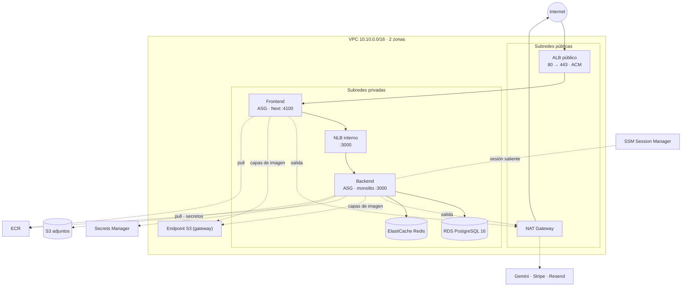

# PRAXIS en AWS (Terraform)

Una versión equivalente de [`infra/terraform/`](../terraform/) (Google Cloud) para
AWS: la misma arquitectura, con los mismos flujos de red y las mismas decisiones,
traducida servicio a servicio.

> ⚠️ **Estado: validada, no desplegada.** Esta pila pasa `terraform fmt`,
> `terraform validate`, `tflint` y `trivy config` (resultados en el PR). **Nunca
> se ha ejecutado `terraform plan` contra una cuenta real ni `terraform apply`**:
> no había credenciales de AWS donde se escribió. Es código revisado, no
> comprobado en vivo; espera algún ajuste en el primer `plan`.
>
> **Producción sigue en Railway** ([`docs/deploy/RAILWAY.md`](../../docs/deploy/RAILWAY.md)).
> Esto es una alternativa, igual que lo es la pila de GCP: no sustituye nada y
> nada de lo que ya funciona depende de esta carpeta.

---

## Arquitectura



**Solo hay una puerta**: el ALB. El gateway, la base de datos y Redis no tienen IP
pública ni regla de entrada desde internet. El navegador nunca habla con el
backend: el frontend expone su proxy (`/api/gateway`) y la llamada al gateway sale
del servidor de Next, ya dentro de la VPC.

Cada máquina del backend corre el **monolito** (gateway, ocho servicios y collab en
un solo proceso Node), tal como lo describe
[`docs/PLAN-MONOLITO.md`](../../docs/PLAN-MONOLITO.md). Sin estado en el proceso:
la sesión es un JWT y lo compartido vive en RDS y Redis.

## Equivalencias GCP → AWS

| GCP (`infra/terraform/`) | AWS (`infra/aws/`) | Dónde | Nota |
|---|---|---|---|
| VPC + subred regional | VPC + 2 subredes públicas + 2 privadas | `network.tf` | Una subred de AWS vive en **una zona**; un ALB exige dos |
| Cloud NAT (opcional, apagado) | NAT Gateway (**obligatorio**) | `network.tf` | AWS no tiene «Acceso Privado a Google» para todo: sin NAT no se baja ni Docker. Es lo más caro con el ALB |
| `private_ip_google_access` | Endpoint de S3 tipo *gateway* | `network.tf` | Gratis; evita pasar por el NAT las capas de ECR (que viven en S3) |
| Reglas de cortafuegos (por etiqueta) | Security Groups (por grupo origen) | `seguridad.tf` | Mismos flujos. Sin reglas de health check: las comprueba el propio balanceador |
| Cloud SQL PostgreSQL 16, IP privada | RDS PostgreSQL 16, subred privada | `datos.tf` | `db.t4g.micro`, cifrado, sin IP pública |
| Redis en una VM (COS) | **ElastiCache** Redis 7.1 | `datos.tf` | Ver «Decisiones» |
| Instance Templates | Launch Templates | `backend.tf`, `frontend.tf` | Amazon Linux 2023 en vez de Container-Optimized OS; IMDSv2 obligatorio |
| MIG regional + autoscaler | Auto Scaling Group + target tracking de CPU | `backend.tf`, `frontend.tf` | `health_check_type = "ELB"` es el autocurado |
| `update_policy` PROACTIVE | `instance_refresh` Rolling (100 % sano, 200 % máx.) | ídem | Levanta antes de retirar |
| LB HTTPS externo + cert. gestionado | ALB + ACM | `frontend.tf` | **Exige dominio propio**; ver «Dominio» |
| Redirección 80 → 443 | Escucha 80 con `redirect` 301 | `frontend.tf` | Necesaria: la cookie de sesión es `Secure` |
| LB interno (passthrough) | NLB interno | `backend.tf` | Sin IP fija: el estable es su nombre DNS |
| Secret Manager | Secrets Manager | `secretos.tf` | Los mismos 11 secretos |
| Cuenta de servicio de las VMs (una) | **Dos** roles de IAM + perfiles de instancia | `iam.tf` | El frontend solo lee el secreto que firma la cookie |
| Artifact Registry | ECR (un repo por imagen) | `ecr.tf` | Retención: las 5 últimas |
| Bucket GCS de adjuntos | Bucket S3 privado y cifrado | `storage.tf` | ⚠️ El backend **no tiene driver de S3** todavía |
| SSH por IAP | SSM Session Manager | `iam.tf` | Sin puerto 22, sin claves, con registro en CloudTrail |
| Cloud Logging (`gcplogs`) | CloudWatch Logs (`awslogs`) | `logs.tf` | Grupos creados a mano, con retención |
| Estado en GCS | Estado en S3 con `use_lockfile` | `versions.tf` | Terraform ≥ 1.10; sin DynamoDB |
| Cloud Build (`infra/ci/`) | GitHub Actions + OIDC | `ci.tf`, `.github/workflows/aws-ecr.yml` | Sin claves; solo sube imágenes |
| APIs de GCP (`apis.tf`) | — | — | AWS no tiene el equivalente: no hay nada que encender |

## Decisiones que conviene revisar

**Redis: ElastiCache, no EC2.** La pila de GCP usa una VM porque Memorystore
partía de ~35 USD frente a ~7 de una e2-micro. En AWS la diferencia casi no
existe (~12 USD frente a ~8 de una `t4g.micro` con su disco) y una EC2 suelta
obliga a lo que de verdad cuesta: un ASG de tamaño 1 solo para que reaparezca,
una interfaz de red fija para que la IP no cambie, una AMI que parchear y la
copia manual de la imagen de Redis a un registro. Se pierde la paridad exacta y
~4 USD/mes. Se mantiene lo que ya tenía el Redis de la VM: sin persistencia,
`allkeys-lru`, sin contraseña (su seguridad es el grupo de seguridad).

**Dos roles de IAM en vez de uno.** GCP comparte una cuenta de servicio entre
todas las máquinas y compensa dando los secretos uno por uno. Aquí el rol del
frontend solo puede leer `jwt-secret`: si alguien entra en una máquina del
frontend —la que ejecuta Next y más superficie tiene— no alcanza la contraseña de
la base ni las claves de Stripe.

**NLB interno, sin IP fija.** GCP reserva una dirección interna para que el
frontend apunte a algo estable. En AWS lo estable es el nombre DNS del NLB. Si se
recrea el balanceador, el nombre cambia y hay que reemplazar las máquinas del
frontend (mismo motivo, otra forma).

**Un solo health check por grupo.** GCP tiene dos: uno rápido que quita tráfico y
otro tolerante que destruye la máquina. Un NLB obliga a umbrales iguales y no
deja fijar el timeout, así que en el backend es uno solo y se queda en el término
medio (3 fallos de 30 s ≈ 90 s).

**`rds.force_ssl = 0`.** Desde PostgreSQL 15 RDS exige TLS, y las cadenas de
conexión que arman `start-backend.sh` y `migrar.sh` no llevan `sslmode`. Con el
valor por defecto el backend no conecta. Es el mismo trato que Cloud SQL con IP
privada, y el tráfico no sale de las subredes privadas, pero **es una debilidad
real**. La deuda: añadir `sslmode=require` a esas cadenas y volver el parámetro a
`1`. Es un cambio de backend y queda fuera de este PR.

## Limitaciones conocidas (honestas)

1. **Sin dominio, no se puede usar la aplicación.** Sin `dominio` el ALB sirve
   solo por HTTP, y la cookie de sesión es `Secure` en producción
   (`apps/frontend/commons/auth/cookies.ts`): el navegador no la manda por HTTP,
   así que **el login no se mantiene**. Sirve para ver la landing y comprobar que
   la infraestructura responde. El truco de **sslip.io que usa GCP no funciona con
   ACM**: ACM valida que controlas el dominio y no hay forma de poner un registro
   en el de otro.
2. **Los adjuntos del chat siguen en Postgres.** `projects-service` y
   `assistant-service` solo tienen drivers `postgres` y `gcs`. El bucket de S3 y su
   permiso están creados y listos, pero `STORAGE_DRIVER` se queda en `postgres`
   hasta que alguien escriba el driver de S3 (trabajo de backend).
3. **Las migraciones las hace la imagen al arrancar**, no un paso manual como
   documenta `docs/despliegue.md` para GCP: la imagen actual (`start-backend.sh`,
   hecha para Railway) las aplica sola. Con más de una máquina arrancando a la
   vez (un despliegue continuo con 2 backends) Prisma toma un bloqueo y la segunda
   falla con un error confuso; el script lo tolera y sigue. Con `minimo_instancias = 1`
   no hay carrera.
4. **Desplegar una imagen nueva no es automático**: las máquinas bajan `latest` al
   arrancar, así que hay que reemplazarlas (`instance refresh`, abajo). El workflow
   solo sube imágenes, a propósito.
5. **Un solo NAT por defecto**: si cae su zona, las máquinas de la otra pierden la
   salida (Gemini, Stripe, Resend) aunque sigan vivas. `nat_por_zona = true` lo
   arregla por ~33 USD/mes más.
6. **El estado contiene los secretos en claro** (los genera `random_password`).
   El bucket del estado tiene que ser privado, cifrado y versionado.

## Variables

Los valores reales van en `terraform.tfvars` (no se versiona). Plantilla:
[`terraform.tfvars.example`](terraform.tfvars.example). Todas tienen valor por
defecto, así que una demo no exige ninguna.

| Variable | Por defecto | Qué hace |
|---|---|---|
| `region` | `us-east-1` | Región de todo |
| `prefijo` | `praxis` | Prefijo de los nombres (≤ 19 caracteres) |
| `rango_vpc` | `10.10.0.0/16` | Rango de la VPC |
| `nat_por_zona` | `false` | Un NAT por zona (alta disponibilidad, +33 USD/mes) |
| `cidrs_permitidos_alb` | `["0.0.0.0/0"]` | Quién llega al ALB. Acótalo en una demo privada |
| `tipo_instancia_backend` / `_frontend` | `t3.medium` | x86 a propósito: las imágenes son x86-64 |
| `minimo_instancias` / `maximo_instancias` | `1` / `3` | Límites del autoescalado |
| `objetivo_cpu` | `60` | % de CPU que dispara una máquina más |
| `clase_rds` | `db.t4g.micro` | Clase de RDS |
| `almacenamiento_rds_gb` | `20` | Disco inicial (crece hasta el triple) |
| `rds_multi_az` | `false` | Réplica síncrona. Duplica el precio de RDS |
| `borrado_protegido_rds` | `true` | Protege la base y deja copia final. **`false` antes de destruir una prueba** |
| `clase_redis` | `cache.t4g.micro` | Nodo de ElastiCache |
| `etiqueta_imagen` | `latest` | Etiqueta de las imágenes en ECR |
| `dominio` | `""` | Vacío = solo HTTP (demo sin login) |
| `zona_route53_id` | `""` | Si el DNS está en Route 53, Terraform crea los registros |
| `gemini_api_key`, `mail_api_key`, `stripe_*` | `""` | Secretos. Vacío = esa función apagada, no el despliegue |
| `google_client_id`, `mail_from` | — | Configuración no secreta de la aplicación |
| `dias_recuperacion_secretos` | `7` | `0` = borrado inmediato (pruebas que se montan y desmontan el mismo día) |
| `retencion_logs_dias` | `14` | Retención de CloudWatch |
| `github_repo` | `""` | `organizacion/repo`. Vacío = no se crea el rol OIDC |
| `rama_github_despliegue` | `main` | Única rama que puede asumir el rol |
| `crear_proveedor_oidc_github` | `true` | `false` si la cuenta ya tiene el proveedor OIDC de GitHub |

## Requisitos

- Terraform **≥ 1.10** (por `use_lockfile`).
- AWS CLI con credenciales **temporales** (`aws sso login` o un rol asumido). No
  crees claves de acceso para esto.
- Docker, solo si vas a subir las imágenes a mano (en Apple Silicon es lento:
  el build es `linux/amd64`; usa el workflow).
- Permisos suficientes para crear VPC, EC2, RDS, ElastiCache, IAM, ECR, S3, ACM y
  Secrets Manager. Para una prueba, `AdministratorAccess` en una cuenta de
  pruebas; no uses la cuenta de producción de nadie.

## Inicializar

El bucket del estado se crea **a mano, una sola vez**: Terraform no puede guardar
su estado en algo que aún no ha creado.

```bash
REGION=us-east-1
CUENTA=$(aws sts get-caller-identity --query Account --output text)
ESTADO="praxis-tfstate-$CUENTA"          # único en todo S3

# En us-east-1 NO se pasa LocationConstraint; en cualquier otra región, sí:
#   --create-bucket-configuration LocationConstraint=$REGION
aws s3api create-bucket --bucket "$ESTADO" --region "$REGION"

aws s3api put-bucket-versioning --bucket "$ESTADO" \
  --versioning-configuration Status=Enabled
aws s3api put-bucket-encryption --bucket "$ESTADO" \
  --server-side-encryption-configuration \
  '{"Rules":[{"ApplyServerSideEncryptionByDefault":{"SSEAlgorithm":"AES256"}}]}'
aws s3api put-public-access-block --bucket "$ESTADO" \
  --public-access-block-configuration \
  BlockPublicAcls=true,IgnorePublicAcls=true,BlockPublicPolicy=true,RestrictPublicBuckets=true

cd infra/aws
cp terraform.tfvars.example terraform.tfvars   # y rellénalo
terraform init \
  -backend-config="bucket=$ESTADO" \
  -backend-config="region=$REGION"
```

## Desplegar

**El orden importa**: los repositorios de ECR nacen vacíos, y un grupo de
autoescalado cuyas máquinas no encuentran imagen entra en un bucle de
reemplazos (el apply no falla —`wait_for_capacity_timeout = 0`—, pero cuesta
dinero y confunde).

```bash
# 1. Solo los repositorios de ECR
terraform apply -target=aws_ecr_repository.imagenes

# 2. Las imágenes. Con el workflow (recomendado; requiere github_repo, ver CI):
#    Actions → «Imágenes a ECR (AWS)» → Run workflow
#    O a mano, desde la raíz del repo:
REGISTRO=$(terraform -chdir=infra/aws output -raw registro)
aws ecr get-login-password --region "$REGION" \
  | docker login --username AWS --password-stdin "$REGISTRO"
docker buildx build --platform linux/amd64 \
  -f infra/docker/images/backend.Dockerfile \
  -t "$REGISTRO/praxis/backend:latest" --push .
# Los valores públicos de Next se incrustan al construir el frontend; vacíos
# (o sin la línea) la función correspondiente queda apagada.
docker buildx build --platform linux/amd64 \
  -f infra/docker/images/frontend.Dockerfile \
  --build-arg GOOGLE_CLIENT_ID="$GOOGLE_CLIENT_ID" \
  --build-arg NEXT_PUBLIC_PRECIO_PRO="$NEXT_PUBLIC_PRECIO_PRO" \
  --build-arg NEXT_PUBLIC_PRECIO_TEAM="$NEXT_PUBLIC_PRECIO_TEAM" \
  --build-arg NEXT_PUBLIC_PRECIO_BUSINESS="$NEXT_PUBLIC_PRECIO_BUSINESS" \
  --build-arg NEXT_PUBLIC_KYLOO_LOGIN="$NEXT_PUBLIC_KYLOO_LOGIN" \
  -t "$REGISTRO/praxis/frontend:latest" --push .

# 3. Solo si hay dominio y su DNS NO está en Route 53 (si lo está, salta al 4):
terraform apply -target=aws_acm_certificate.sitio
terraform output registros_validacion_acm     # crea esos CNAME en tu proveedor de DNS

# 4. Todo lo demás. Con dominio, espera aquí a que ACM valide el certificado
terraform apply

# 5. Si el DNS no está en Route 53: apunta el dominio (y `www`) al ALB
terraform output alb_dns                       # CNAME / alias hacia este nombre
terraform output siguientes_pasos
```

⚠️ El ALB tarda 2-3 minutos en nacer y las máquinas, 5-8 en llegar a sanas
(instalar Docker, bajar ~550 MB, migrar, arrancar el monolito). `502` durante ese
rato es normal.

### Entrar a una máquina (sin SSH)

```bash
aws ssm start-session --target <id-de-instancia>
sudo journalctl -u praxis -n 100 --no-pager
```

Un túnel a RDS desde el repo (el equivalente del túnel por IAP de GCP), para
migrar una migración que todavía no está en la imagen desplegada:

```bash
aws ssm start-session --target <id-backend> \
  --document-name AWS-StartPortForwardingSessionToRemoteHost \
  --parameters host="$(terraform output -raw rds_endpoint)",portNumber="5432",localPortNumber="5433"
# En otra terminal: la misma receta de docs/despliegue.md, contra localhost:5433.
# La contraseña: terraform output -raw password_sql
```

### Desplegar una versión nueva

Las máquinas bajan `latest` al arrancar, así que, tras subir imágenes nuevas:

```bash
for g in backend frontend; do
  aws autoscaling start-instance-refresh --auto-scaling-group-name praxis-$g \
    --preferences '{"MinHealthyPercentage":100,"MaxHealthyPercentage":200,"InstanceWarmup":300}'
done
```

Levanta la nueva antes de retirar la vieja. Para **volver atrás**, se
re-etiqueta como `latest` la imagen del SHA bueno y se repite el refresh.

### CI (opcional)

`.github/workflows/aws-ecr.yml` construye las dos imágenes y las sube a ECR **por
OIDC, sin claves**. Para usarlo:

1. En `terraform.tfvars`: `github_repo = "organizacion/repo"` y `terraform apply`.
2. En GitHub → Settings → Secrets and variables → Actions → **Variables**:
   `AWS_ROLE_ARN` (`terraform output rol_github_ecr`), `AWS_REGION` y, si los usas,
   `GOOGLE_CLIENT_ID`, `NEXT_PUBLIC_PRECIO_PRO`, `NEXT_PUBLIC_PRECIO_TEAM`,
   `NEXT_PUBLIC_PRECIO_BUSINESS` y `NEXT_PUBLIC_KYLOO_LOGIN`.
3. Actions → «Imágenes a ECR (AWS)» → Run workflow.

Solo se lanza a mano y solo puede subir imágenes: el rol no toca el
autoescalado ni la infraestructura. El workflow **no se ha ejecutado nunca**.
Siguiente paso, si esta pila llega a producción: dispararlo en cada push a
`main` y añadir el `instance refresh`.

## Destruir

⚠️ **Destruye al terminar una prueba. Esta pila cuesta dinero cada hora que
existe, la uses o no** (el NAT y los dos balanceadores cobran por estar encendidos,
no por el tráfico).

```bash
# En terraform.tfvars, ANTES de destruir:
#   borrado_protegido_rds      = false   (si no, el destroy falla a mitad)
#   dias_recuperacion_secretos = 0       (si no, no podrás volver a aplicar hoy)
terraform apply        # aplica solo ese cambio
terraform destroy
```

Después, comprueba que no quedó nada cobrando:

```bash
aws resourcegroupstaggingapi get-resources --region "$REGION" \
  --tag-filters Key=Proyecto,Values=praxis --query 'ResourceTagMappingList[].ResourceARN'
```

Lo que `destroy` **no** borra, porque está fuera de la pila: el bucket del estado
(`praxis-tfstate-<cuenta>`, vacíalo con sus versiones y bórralo) y, si lo
creaste, el proveedor OIDC de GitHub.

## Costo mensual aproximado

Precios de lista de `us-east-1`, bajo demanda, **estimados de la tarifa pública y
no medidos**: contrástalos con la
[calculadora de AWS](https://calculator.aws/) antes de fiarte. Configuración por
defecto (1 máquina por grupo, un NAT, sin Multi-AZ), 730 h/mes, sin tráfico
relevante.

| Recurso | USD/mes | Nota |
|---|---:|---|
| **NAT Gateway** (1) | ~33 | **Caro.** 0,045 USD/h + 0,045 USD/GB procesado. ×2 con `nat_por_zona` |
| **ALB público** | ~18 | **Caro.** 0,0225 USD/h + LCU |
| NLB interno | ~17 | 0,0225 USD/h + NLCU |
| EC2 `t3.medium` × 2 | ~61 | Backend y frontend. Sube con el autoescalado |
| EBS gp3 20 GB × 2 | ~3 | |
| RDS `db.t4g.micro` + 20 GB | ~14 | ×2 con `rds_multi_az` |
| ElastiCache `cache.t4g.micro` | ~12 | |
| IPv4 públicas × 3 | ~11 | 0,005 USD/h cada una: la del NAT y las dos del ALB |
| Secrets Manager × 11 | ~4 | 0,40 USD por secreto |
| CloudWatch Logs | ~2 | Depende del volumen; con retención de 14 días |
| ECR + S3 | ~1 | |
| **Total aproximado** | **~175** | **≈ 0,24 USD/h ≈ 6 USD/día** |

Se suman, si aplican: tráfico de salida a internet (0,09 USD/GB), una zona
alojada de Route 53 (0,50 USD) y el tráfico entre zonas. El **NAT y los dos
balanceadores son ~38 % de la factura** y cobran aunque nadie entre.

## Seguridad: qué se aceptó del escáner

`trivy config` marca hallazgos que **se aceptan a propósito**. Ninguno es un
olvido:

| Hallazgo | Dónde | Por qué se acepta |
|---|---|---|
| **AWS-0104** egreso `0.0.0.0/0` (crítico) | `seguridad.tf` | Las máquinas necesitan ECR, Secrets Manager, SSM, Gemini, Stripe y Resend, y ninguna tiene IP fija. Lo que protege es que **nada entra**: sin IP pública y sin reglas de entrada ajenas, salir no expone nada |
| **AWS-0054** HTTP plano (crítico) | `frontend.tf` | Con dominio, el 80 solo redirige con un 301. Sin dominio es el modo demostración, avisado en este README |
| **AWS-0053** balanceador expuesto | `frontend.tf` | Es la única puerta pública del sistema, por diseño. `cidrs_permitidos_alb` lo acota |
| **AWS-0031** etiquetas de imagen mutables | `ecr.tf` | Las plantillas apuntan a `latest` para que desplegar no exija un `terraform apply`. El SHA se guarda igual para trazabilidad |
| **AWS-0132 / 0033 / 0098 / 0017** sin clave KMS propia | S3, ECR, Secrets Manager, logs | Todo está cifrado con claves administradas por AWS. Una clave propia cuesta 1 USD/mes cada una y no añade aquí nada que el IAM acotado ya dé |
| **AWS-0090** S3 sin versionado | `storage.tf` | La aplicación sobrescribe o borra; guardar versiones solo encarecería (igual que en GCS) |
| **AWS-0089** S3 sin registro de acceso | `storage.tf` | Exigiría otro bucket y su política. Los adjuntos no se sirven directos, pasan por el gateway |
| **AWS-0050** Redis sin copias | `datos.tf` | Es solo caché y límites de intentos; se rellena sola |
| **AWS-0176** RDS sin autenticación IAM | `datos.tf` | La aplicación se conecta con contraseña; pasar a IAM es un cambio de backend |
| **AWS-0133** sin Performance Insights | `datos.tf` | No existe en `db.t4g.micro` |

Y lo que **no** se acepta y está resuelto: IMDSv2 obligatorio, discos cifrados,
RDS y Redis sin IP pública, sin puerto 22, sin claves de acceso (roles y OIDC),
`aws:SecureTransport` forzado en S3, rol de CI atado a repo y rama.

## Validación realizada

Ver la descripción del PR para la salida literal.

- ✅ `terraform fmt -check -recursive`
- ✅ `terraform init -backend=false && terraform validate`
- ✅ `tflint` (ruleset `aws` 0.40)
- ✅ `trivy config` (hallazgos arriba, todos revisados)
- ⏳ `terraform plan`: **pendiente**, requiere credenciales de AWS
- ❌ `terraform apply`: **no ejecutado**. El script de arranque, el workflow y las
  rutas de salud (`/api` en el 3000, `/` en el 4100) están razonados contra el
  código y las plantillas de GCP, pero no probados en una máquina real
